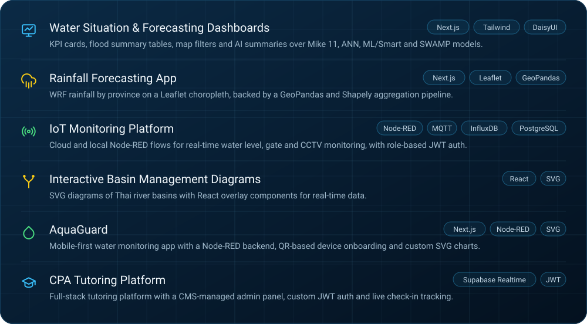

  
  

## About

I'm a developer and IT enthusiast who likes building practical systems on both sides of the software and hardware line: web apps and APIs, IoT devices, network infrastructure, CCTV and geospatial data platforms.

A lot of my work turns water data (sensors, rainfall forecasts, flood models) into dashboards and maps that are easy to read at a glance.

**Currently exploring:** cloud infrastructure, IoT and MQTT, geospatial data and visualization, network infrastructure, API security and system integration.

## From sensor to screen

## Featured work

## Tech stack

| Area | What I use |
| :-- | :-- |
| **Web & frontend** | JavaScript, HTML, CSS, React, Next.js, Tailwind CSS, DaisyUI, Bootstrap, PHP, Node.js, Vercel, Cloudflare |
| **Backend & data** | PostgreSQL, MySQL, Supabase, Prisma, InfluxDB, REST APIs, Row Level Security (RLS), authentication and OAuth, SMTP and email services |
| **IoT & embedded** | Arduino, C++, ESP32, ESP32-CAM (AI Thinker), GPS with Neo-6M and TinyGPS++, MQTT, Node-RED, Blynk, WiFiManager, servo control |
| **GIS & geospatial** | Python, QGIS, Leaflet, GeoJSON, GeoPandas, Shapely, Fiona, PyProj, RTree, NetCDF |
| **CCTV & networking** | Hikvision, HikCentral, IP and PTZ cameras, network monitoring, Ruijie Cloud |
| **Tools** | Git, GitHub, VS Code, Arduino IDE, XAMPP |

## GitHub activity

  
  

  

 

  Feel free to explore my repositories and projects. 
  <em>Build it. Test it. Break it. Fix it. Learn from it.</em>

  

<!--
  Add contact links here if you like, for example:
  
  
-->
